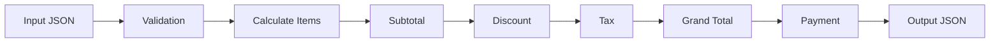

# Meet 06 - Sales & Invoice Calculator

Workshop ini membuat aplikasi CLI kasir sederhana yang membaca transaksi dari file JSON, menghitung invoice, lalu mencetak hasil JSON terstruktur.

## Deskripsi Studi Kasus

Toko retail kecil membutuhkan program kasir sederhana. Kasir mencatat produk, harga satuan, jumlah beli, diskon, pajak simulasi, ongkir, dan uang yang dibayar pelanggan.

Program harus menghitung:

1. Total per item.
2. Subtotal transaksi.
3. Diskon persen.
4. Subtotal setelah diskon.
5. Pajak simulasi.
6. Ongkir.
7. Total akhir.
8. Uang dibayar.
9. Kembalian.
10. Status transaksi.

Catatan: pajak di latihan ini adalah parameter simulasi belajar, bukan aturan pajak Indonesia saat ini.

## Tujuan Pembelajaran

- Menerjemahkan kebutuhan bisnis menjadi logika program.
- Membuat model domain dengan `struct`.
- Memproses banyak item memakai slice.
- Membuat function perhitungan yang bisa dipakai ulang.
- Memakai kondisi untuk aturan bisnis.
- Menghitung uang dengan `int64`, bukan `float64`.
- Memvalidasi data transaksi yang tidak valid.
- Mengembalikan error dengan pola `(value, error)`.
- Membaca input JSON dan menghasilkan output JSON.
- Memisahkan business logic dari input/output.

## Prasyarat dari Meet 01-05

- Meet 01: setup Go dan menjalankan program.
- Meet 02: variable, operator, kondisi, loop, function, slice, struct, error.
- Meet 03: pemecahan program ke beberapa file dan function.
- Meet 04: membaca dan menulis JSON.
- Meet 05: struktur handler dan test, tetapi Meet 06 tidak memakai HTTP.

## Konsep yang Digunakan

- `struct` dan JSON tag.
- Slice dan perulangan `for`.
- Function dengan return error.
- Integer arithmetic dengan `int64`.
- Validasi input.
- Table-driven test.
- Pemisahan `main.go` dan `calculator.go`.

## Alur Proses Bisnis



Urutan perhitungan wajib:

1. `line_total = unit_price * quantity`
2. `subtotal = jumlah semua line_total`
3. `discount_amount = subtotal * discount_percent / 100`
4. `after_discount = subtotal - discount_amount`
5. `tax_amount = after_discount * tax_percent / 100`
6. `grand_total = after_discount + tax_amount + shipping_fee`
7. `change = amount_paid - grand_total`
8. `status = "paid"` jika pembayaran cukup.

## Model Data

- `Customer`: nama dan tipe pelanggan.
- `TransactionItem`: SKU, nama produk, harga satuan, dan jumlah.
- `InvoiceRequest`: data input dari JSON.
- `InvoiceItemResult`: hasil hitung per item.
- `InvoiceSummary`: ringkasan subtotal sampai status.
- `InvoiceResult`: output akhir invoice.

Semua nilai uang memakai `int64` karena Rupiah tidak membutuhkan pecahan desimal di latihan ini.

## Rumus Perhitungan

Persentase dihitung memakai integer:

```go
amount * percent / 100
```

Pembulatan wajib ke Rupiah terdekat. Jika sisa tepat `0.5`, bulatkan ke atas.

Contoh:

- `585000 * 11 / 100 = 64350`
- `5 * 10 / 100 = 0.5`, hasil menjadi `1`

Hint kecil: hitung `amount * percent`, bagi `100`, lalu lihat sisa pembagian.

## Contoh Input JSON

```json
{
  "invoice_number": "INV-2026-0001",
  "customer": {
    "name": "Budi Santoso",
    "type": "regular"
  },
  "items": [
    {
      "sku": "PRD-001",
      "name": "Mechanical Keyboard",
      "unit_price": 250000,
      "quantity": 2
    },
    {
      "sku": "PRD-002",
      "name": "Wireless Mouse",
      "unit_price": 150000,
      "quantity": 1
    }
  ],
  "discount_percent": 10,
  "tax_percent": 11,
  "shipping_fee": 20000,
  "amount_paid": 700000
}
```

## Contoh Output JSON

```json
{
  "invoice_number": "INV-2026-0001",
  "customer_name": "Budi Santoso",
  "items": [
    {
      "sku": "PRD-001",
      "name": "Mechanical Keyboard",
      "quantity": 2,
      "unit_price": 250000,
      "line_total": 500000
    },
    {
      "sku": "PRD-002",
      "name": "Wireless Mouse",
      "quantity": 1,
      "unit_price": 150000,
      "line_total": 150000
    }
  ],
  "summary": {
    "subtotal": 650000,
    "discount_amount": 65000,
    "after_discount": 585000,
    "tax_amount": 64350,
    "shipping_fee": 20000,
    "grand_total": 669350,
    "amount_paid": 700000,
    "change": 30650,
    "status": "paid"
  }
}
```

## Cara Menjalankan Aplikasi

```bash
cd starter/meet-06
go run . data/invoice-valid.json
go test ./...
go fmt ./...
```

Saat baru dibuka, test akan gagal karena function masih berisi TODO. Itu disengaja.

## Instruksi Pengerjaan TODO

Lengkapi function berikut:

- `CalculateLineTotal`
- `CalculateDiscount`
- `CalculateTax`
- `CalculateChange`
- `ValidatePercent`
- `ValidateRequest`
- `CalculateInvoice`

Aturan validasi:

- Item tidak boleh kosong.
- SKU dan nama produk tidak boleh kosong.
- Quantity harus lebih dari 0.
- Unit price tidak boleh negatif.
- Diskon dan pajak harus 0 sampai 100.
- Ongkir tidak boleh negatif.
- Pembayaran tidak boleh negatif.
- Pembayaran harus cukup untuk grand total.
- Perhitungan tidak boleh overflow `int64`.

## Skenario Pengujian

Test mencakup:

- Satu item.
- Beberapa item.
- Diskon nol.
- Diskon dan pajak.
- Ongkir.
- Pembayaran pas.
- Pembayaran kurang.
- Quantity tidak valid.
- Harga negatif.
- Item kosong.
- Persentase tidak valid.
- Overflow.
- Pembulatan persentase.

## Kriteria Keberhasilan

- `go test ./...` lulus.
- `go run . data/invoice-valid.json` menghasilkan JSON invoice benar.
- Error validasi mudah dipahami.
- Business logic berada di `calculator.go` dan `validation.go`, bukan di `main.go`.
- Tidak memakai dependency pihak ketiga.
- Tidak memakai `float32` atau `float64` untuk uang.

## Pertanyaan Refleksi

1. Kenapa uang lebih aman dihitung dengan integer?
2. Kenapa validasi dilakukan sebelum perhitungan?
3. Bagian mana yang paling mudah salah jika urutan perhitungan berubah?
4. Apa manfaat memisahkan `main.go` dari `calculator.go`?
5. Error message seperti apa yang membantu user memperbaiki JSON?

## Challenge Tambahan

- Diskon tambahan untuk customer `member`.
- Batas maksimum diskon.
- Voucher nominal tetap.
- Pilihan aturan diskon lain.
- Receipt teks yang mudah dibaca manusia.

Challenge ini opsional dan bukan prasyarat Meet 07.

## Jadwal Workshop 4 Jam

| Waktu | Aktivitas |
|---|---|
| 08.00-08.30 | Review struct, slice, function, dan JSON |
| 08.30-09.00 | Studi kasus bisnis dan flow perhitungan |
| 09.00-09.45 | Implementasi model dan line total bersama instruktur |
| 09.45-10.30 | Peserta implementasi subtotal dan diskon |
| 10.30-11.15 | Peserta implementasi pajak, grand total, dan pembayaran |
| 11.15-12.00 | Testing, debugging, dan code review |

Untuk sesi 3 jam, lewati challenge tambahan dan fokus sampai semua test utama lulus.
